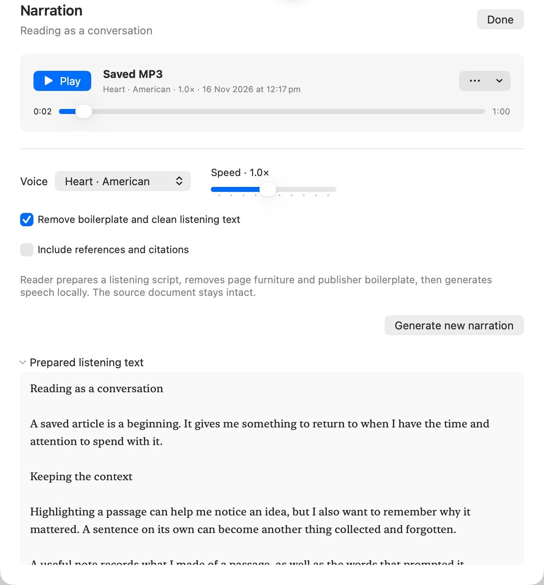

# Reader

A personal macOS library for saved articles, PDFs, notes and local narration.

I wanted somewhere calm to keep the things I want to read. An article saved for later is useful, but I also wanted its highlights, my notes and my place in the text to stay together. Reader is my attempt at making that small part of the reading process easier to look after.

It also brings in the local narration pipeline from [Read To Me](https://github.com/pmancaz/R2M). I can read a document, make notes around it, or prepare an MP3 to listen to away from the screen. The original stays intact.

[Project page](https://pcarroll.au/tools/reader/) · [Installation](#installation) · [Storage and recovery](docs/STORAGE.md) · [Narration](docs/NARRATION.md)


*Original example text in a separate demonstration library.*

## What it does

- Saves one or several article/PDF URLs, or copies imported PDF files into a managed library.
- Keeps saved articles and their cached images available offline. PDFs use native PDFKit rendering, selection, search and zoom.
- Stores highlights, passage notes, document notes, reading position and simple tags.
- Provides Inbox, All items, Favourites, Archive and recoverable Trash, with search across document text and notes.
- Generates narration locally with five English voices and an adjustable speed, then plays or exports a 192 kbps MP3.
- Creates consistent library snapshots, restores into a new folder, and exports notes and highlights as Markdown.
- Includes light, dark and system appearance, article typography controls and a reading mode that hides the library.

The interface uses SwiftUI/AppKit, PDFKit and an isolated WebKit reader. I chose the native PDF tools so selection and annotation geometry could stay in PDF page coordinates. Articles use Mozilla Readability and DOMPurify; they are saved as sanitised local content rather than shown as a live website.

## Installation

This is a **source publication**, for **Apple Silicon Macs running macOS 14 or later**. No app installer, model weights or Python runtime binaries are included in this repository. Testing has been on a newer Apple Silicon Mac; macOS 14 is the deployment target, rather than a claim of testing on every supported system.

The reading library works without the narration dependencies. Install Apple's Command Line Tools with `xcode-select --install` if needed, and use a Swift 6 or later toolchain:

```sh
git clone https://github.com/pmancaz/Reader.git
cd Reader
./scripts/build.sh release
open build/Reader.app
```

For a development run:

```sh
swift run --build-system native Reader
```

The build script replaces only `build/Reader.app`. It does not remove `ReaderData`. The app is ad-hoc signed for local use; Developer ID signing and Apple notarisation for distribution have not been done. The current Command Line Tools setup needs `--build-system native`, which this Swift toolchain warns is deprecated. A future toolchain may need the default build system or full Xcode.

### Optional local narration

Narration needs a separate Python/FFmpeg runtime and the speech/cleanup model sets. The current setup path reuses a **prepared R2M app** and its installed models. It does not automatically bootstrap those dependencies from a fresh Reader checkout.

1. Follow [Read To Me's source installation instructions](https://github.com/pmancaz/R2M#installation) and build `R2M.app`. Put the R2M checkout beside Reader, or set `READER_NARRATION_SOURCE` to the prepared app's `Contents/Resources` folder.
2. In R2M's Models window install **Speech** (about 330 MB) and **Enhanced PDF cleanup** (about 879 MB). Paper chat is not used by Reader.
3. Return to the Reader checkout and run:

```sh
./scripts/setup-narration.sh
./scripts/build.sh release
```

For a prepared R2M app elsewhere:

```sh
READER_NARRATION_SOURCE="/path/to/R2M.app/Contents/Resources" \
READER_NARRATION_MODELS="$HOME/Library/Application Support/R2M/Models" \
  ./scripts/setup-narration.sh
```

Setup copies the components into Reader-owned `ReaderRuntime`, verifies model checksums, and leaves R2M unchanged. The rebuilt app includes its Python/FFmpeg runtime; model weights remain in `ReaderRuntime/Models`. A narration-enabled app is about 1.1 GB, plus about 1.1 GB of model weights. After setup, Reader no longer depends on R2M remaining installed. [The narration guide](docs/NARRATION.md) explains paths, provenance and recovery.

## Using it

Use **⌘N** to import URLs and **⌘O** to choose PDFs; PDFs can also be dropped into the window. Select some text to highlight it or attach a note. The notes panel also accepts a note for the whole document. **⌘F** searches the open document, and **⇧⌘F** focuses library search.

Open the **headphones** control, or press **⇧⌘L**, for narration. Choose a voice and speed, decide whether cleanup and references should be included, then generate the MP3. The prepared text can be inspected alongside the saved audio. Reader keeps a reversible cleanup plan as a file; it does not yet provide R2M's per-change restoration editor.



*The narration is a separate listening copy, kept with its source document.*

There is no account, subscription, hosted AI backend or paid service. Fetching an article, preparing a runtime and downloading models need internet access. Reading saved content and generating narration use local files once the required content and models are installed.

## Looking after the library

The first launch creates **`ReaderData` beside the source checkout used to build the app**. On my Mac that is inside the Reader project in Dropbox. The database, document copies, article assets, notes, highlights, progress, completed narrations, backups and exports live there. Moving the app to Applications does not move the library. Keep the library when replacing builds or cleaning the checkout.

Reader remembers a selected library path. If it is missing, the app offers Locate/Retry rather than creating an empty replacement. Use **Open Existing Library** after moving the whole library folder; paths within it are relative. Models and runtime files are regenerable dependencies, separate from reading data and excluded from Git.

This version assumes **one active writer on one Mac**. SQLite snapshots use its backup API and include managed content; restore always targets a new folder. Dropbox is a file synchroniser, not a multi-device database or a guarantee of recovery. Keep a separate backup and test a restore. [Storage and recovery](docs/STORAGE.md) gives the exact layout and limits.

## Models and acknowledgements

I built the reading workflow around other people's open-source components. I did not train these models.

| Role | Component | Licence |
| --- | --- | --- |
| Article extraction | [Mozilla Readability 0.6.0](https://github.com/mozilla/readability/tree/0.6.0) | Apache-2.0 |
| Article sanitisation | [DOMPurify 3.4.18](https://github.com/cure53/DOMPurify/tree/3.4.18) | Apache-2.0 / MPL-2.0; used under Apache-2.0 |
| Speech model | [Kokoro-82M, by hexgrad](https://huggingface.co/hexgrad/Kokoro-82M) | Apache-2.0 |
| Cleanup classifier | [DeBERTa-v3-large-zeroshot-v2.0, by Moritz Laurer](https://huggingface.co/MoritzLaurer/deberta-v3-large-zeroshot-v2.0) | MIT |

Thanks also to [Read To Me/R2M](https://github.com/pmancaz/R2M), [Kokoro/Misaki](https://github.com/hexgrad/kokoro), [PyTorch](https://github.com/pytorch/pytorch), [Transformers](https://github.com/huggingface/transformers), [PyMuPDF/MuPDF](https://github.com/pymupdf/PyMuPDF), [FFmpeg](https://ffmpeg.org/), [eSpeak NG](https://github.com/espeak-ng/espeak-ng), Python and SQLite. The [pinned model manifest](Sources/Reader/Resources/Narration/R2MBackend/models.json), [runtime notices](Sources/Reader/Resources/Narration/R2MBackend/THIRD_PARTY_NOTICES.md), and [licensing note](docs/LICENSING.md) distinguish model weights, runtime libraries and Reader's source.

No overall application licence has been selected for Reader. Public source availability is not itself an open-source licence grant. The retained third-party and R2M-derived files keep their existing licences.

## Verification and limits

```sh
swift run --build-system native ReaderCoreChecks
./scripts/verify.sh
# With narration runtime/models installed:
./scripts/verify.sh --narration
```

[The verification record](docs/VERIFICATION.md) describes the observed checks and their limits. They cover offline article images, quote/context anchors, rotated PDF highlights, persistence, duplicates and failures, complete restore, real local narration and preservation of each PDF page's text. Tests use separate temporary libraries, not personal reading data.

JavaScript-only or authenticated pages may not extract, and Reader does not bypass paywalls. Articles are limited to 12 MB of HTML, PDFs to 100 MB, and cached raster images to 8 MB each (up to 60 images). Missing images produce a warning. Encrypted PDFs need unlocking first. Scanned PDFs remain viewable, but text selection, search and narration need a text layer; OCR is not included. Unusual PDF layouts and automatic cleanup still need checking against the source.

Share extensions, iPhone/iPad, watched-folder and email capture are deferred. [The architecture notes](docs/ARCHITECTURE.md) describe those boundaries, including a future sync approach with a separate database per device. This version does not have paper chat or AI summaries.
