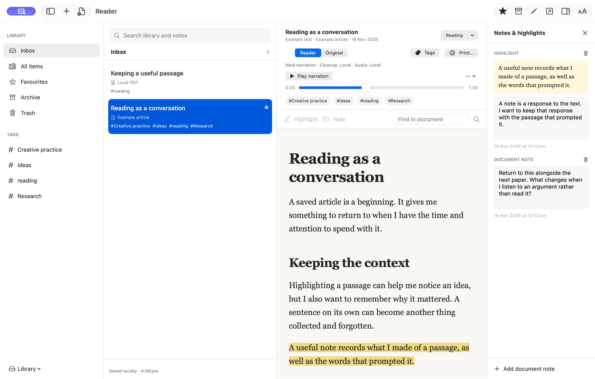
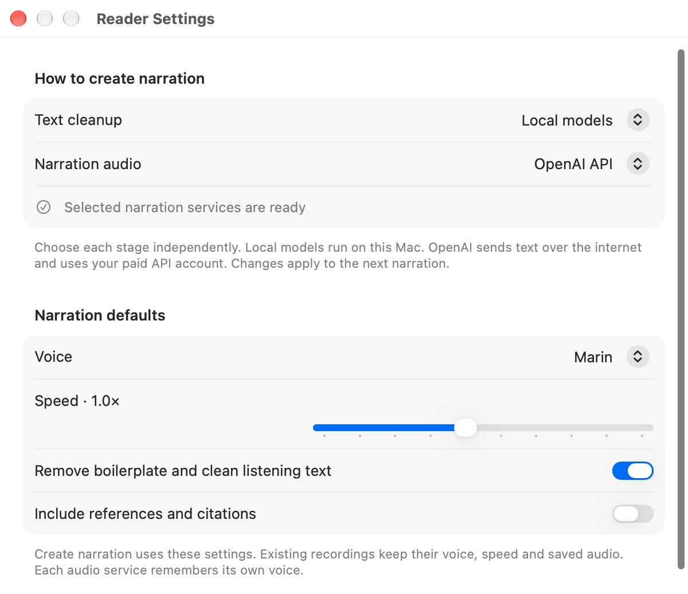

# Reader

A personal macOS library for saved articles, PDFs, notes and narration.

I wanted somewhere calm to keep the things I want to read. An article saved for later is useful, but I also wanted its highlights, my notes and my place in the text to stay together. Reader is my attempt at making that small part of the reading process easier to look after.

I brought in the narration workflow from [Read To Me](https://github.com/pmancaz/R2M) so I could listen to the same document away from the screen. I wanted to compare the local models with OpenAI, so in Reader 0.3.2 I can choose how it cleans up the text and how it produces the audio. I can use local models for the whole thing, use OpenAI for both steps, or mix the two.

[Project page](https://pcarroll.au/tools/reader/) · [Installation](#installation) · [Storage and recovery](docs/STORAGE.md) · [Narration](docs/NARRATION.md)



*Original example text in a separate demonstration library.*

## What it does

- Saves one or several article/PDF URLs, or copies imported PDF files into a managed library.
- Keeps saved articles and their cached images available offline. PDFs use native PDFKit rendering, selection, search and zoom.
- Stores highlights, passage notes, document notes, reading position and simple tags.
- Prints clean, paginated A4 articles and fits existing PDF pages to A4, with a native preview and Save as PDF option.
- Switches between the saved Reader view and the live original website. Original PDF view hides Reader highlights.
- Provides Inbox, All items, Favourites, Archive and recoverable Trash, with search across document text and notes.
- Creates narration in the background with one click, then keeps an inline player with a seek bar and remembered position. Choose local models or OpenAI independently for text cleanup and audio. Export a 192 kbps MP3.
- Creates consistent library snapshots, restores into a new folder, and exports notes and highlights as Markdown.
- Includes light, dark and system appearance, article typography controls and a reading mode that hides the library.

The interface uses SwiftUI/AppKit, PDFKit and an isolated WebKit reader. I chose the native PDF tools so selection and annotation geometry could stay in PDF page coordinates. Articles use Mozilla Readability and DOMPurify; they are saved as sanitised local content rather than shown as a live website.

## Installation

This is a **source publication**, for **Apple Silicon Macs running macOS 14 or later**. No app installer, model weights or Python runtime binaries are included in this repository. Testing has been on a newer Apple Silicon Mac; macOS 14 is the deployment target, rather than a claim of testing on every supported system.

The reading library works without the narration dependencies. Install Apple's Command Line Tools with `xcode-select --install` if needed, and use a Swift 6 or later toolchain:

```sh
git clone https://github.com/pmancaz/Reader.git
cd Reader
./scripts/build.sh release
open build/Reader.app
```

For a development run:

```sh
swift run --build-system native Reader
```

The default build command replaces `build/Reader.app` and keeps the library in `ReaderData`. The app is signed for local use. The current Swift toolchain warns that `--build-system native` is deprecated. A future toolchain may need the default build system or full Xcode.

### Optional local narration

Running both stages locally needs a Python/FFmpeg runtime and the speech and cleanup model sets. The setup path reuses a **prepared R2M app** and its installed models.

1. Follow [Read To Me's source installation instructions](https://github.com/pmancaz/R2M#installation) and build `R2M.app`. Put the R2M checkout beside Reader, or set `READER_NARRATION_SOURCE` to the prepared app's `Contents/Resources` folder.
2. In R2M's Models window install **Speech** (about 330 MB) and **Enhanced PDF cleanup** (about 879 MB). Paper chat is not used by Reader.
3. Return to the Reader checkout and run:

```sh
./scripts/setup-narration.sh
./scripts/build.sh release
```

For a prepared R2M app elsewhere:

```sh
READER_NARRATION_SOURCE="/path/to/R2M.app/Contents/Resources" \
READER_NARRATION_MODELS="$HOME/Library/Application Support/R2M/Models" \
  ./scripts/setup-narration.sh
```

Setup copies the components into Reader-owned `ReaderRuntime`, verifies model checksums, and leaves R2M unchanged. The rebuilt app includes its Python/FFmpeg runtime; model weights remain in `ReaderRuntime/Models`. A narration-enabled app is about 1.1 GB, plus about 1.1 GB of model weights. After setup, Reader no longer depends on R2M remaining installed. [The narration guide](docs/NARRATION.md) explains paths, provenance and recovery.

### Optional OpenAI narration

Choose **OpenAI API** for **Text cleanup**, **Narration audio**, or both in **Reader → Settings… (⌘,)**. Enter your own API key and choose **Save key** to store it in macOS Keychain. OpenAI receives the text needed for the stages you choose. Generation requires internet access and incurs API usage charges. The [narration guide](docs/NARRATION.md#openai-setup) explains which text is sent and how to build with just FFmpeg if you want to run both stages through OpenAI.



## Using it

Use **⌘N** to import URLs and **⌘O** to choose PDFs; PDFs can also be dropped into the window. Select some text to highlight it or attach a note. The notes panel also accepts a note for the whole document. **⌘F** searches the open document, and **⇧⌘F** focuses library search.

Use **Tags** in the document header to add subjects or projects, reuse existing tags, or remove a tag. Select a tag beside a document or in the sidebar to filter the library. Tags are included in library search and persist with the paper.

The **Reader / Original** switch is also in the header. Reader is the saved offline article; Original loads the live website, including its layout and scripts, in a separate ephemeral browser with no access to Reader's library bridge. It needs internet access and the publisher may still require a login or block embedded browsing. Use Open in Browser when needed. Switching back restores the saved reading position. For PDFs, both modes use the original page layout; Original hides Reader's highlight overlays. Following a saved passage note returns to Reader view.

Choose **Print…** or press **⌘P** for A4 output with 15 mm margins. Articles use the clean saved copy, including when Original view is selected; paragraphs paginate, long code and references wrap, and figures fit the printable area. Existing PDF pages are scaled to fit A4 rather than reflowed. The macOS print panel provides preview, page selection and **PDF → Save as PDF**. Printing leaves the managed source unchanged and does not include the notes sidebar or Reader highlight overlays. You can choose a different paper size in the print panel; A4 portrait is Reader's starting layout.

Use **Create narration** at the top of the document, or press **⇧⌘L**. It uses the defaults in **Reader → Settings… (⌘,)** and shows a small progress bar while you continue reading, make notes or open another paper. Voice, generation speed, cleanup and reference settings persist between launches; changing them does not alter an already-running job or saved recording.

When ready, the same control becomes **Play narration**. Play/Pause, a draggable seek bar, elapsed time and total duration stay beside the document. Seeking also works before playback starts, and the playback position is remembered. Narration options provide MP3 export, the prepared script and an explicit **Create new narration** action.

Completed audio is durable library content linked from the article's database record, not an expiring generation cache. Reopening the article later uses the existing MP3 without running the AI models again. Keep the whole library folder and its backups. Reader keeps a reversible cleanup plan as a file; it does not yet provide R2M's per-change restoration editor.

Saved reading and playback work offline. Fetching an article, viewing the live original website, downloading dependencies and using OpenAI need internet access. Both local stages run offline once the document and the models are installed.

## Looking after the library

The first launch creates **`ReaderData` beside the source checkout used to build the app**. On my Mac that is inside the Reader project in Dropbox. The database, document copies, article assets, notes, highlights, progress, completed narrations, backups and exports live there. Moving the app to Applications does not move the library. Keep the library when replacing builds or cleaning the checkout.

Reader remembers a selected library path. If it is missing, the app offers Locate/Retry rather than creating an empty replacement. Use **Open Existing Library** after moving the whole library folder; paths within it are relative. Models and runtime files are regenerable dependencies, separate from reading data and excluded from Git.

This version assumes **one active writer on one Mac**. SQLite snapshots use its backup API and include managed content; restore always targets a new folder. Dropbox is a file synchroniser, not a multi-device database or a guarantee of recovery. Keep a separate backup and test a restore. [Storage and recovery](docs/STORAGE.md) gives the exact layout and limits.

## Models and acknowledgements

I built the reading workflow around other people's open-source components. I did not train these models.

| Role | Component | Licence |
| --- | --- | --- |
| Article extraction | [Mozilla Readability 0.6.0](https://github.com/mozilla/readability/tree/0.6.0) | Apache-2.0 |
| Article sanitisation | [DOMPurify 3.4.18](https://github.com/cure53/DOMPurify/tree/3.4.18) | Apache-2.0 / MPL-2.0; used under Apache-2.0 |
| Speech model | [Kokoro-82M, by hexgrad](https://huggingface.co/hexgrad/Kokoro-82M) | Apache-2.0 |
| Cleanup classifier | [DeBERTa-v3-large-zeroshot-v2.0, by Moritz Laurer](https://huggingface.co/MoritzLaurer/deberta-v3-large-zeroshot-v2.0) | MIT |

Thanks also to [Read To Me/R2M](https://github.com/pmancaz/R2M), [Kokoro/Misaki](https://github.com/hexgrad/kokoro), [PyTorch](https://github.com/pytorch/pytorch), [Transformers](https://github.com/huggingface/transformers), [PyMuPDF/MuPDF](https://github.com/pymupdf/PyMuPDF), [FFmpeg](https://ffmpeg.org/), [eSpeak NG](https://github.com/espeak-ng/espeak-ng), Python and SQLite. The [pinned model manifest](Sources/Reader/Resources/Narration/R2MBackend/models.json), [runtime notices](Sources/Reader/Resources/Narration/R2MBackend/THIRD_PARTY_NOTICES.md), and [licensing note](docs/LICENSING.md) distinguish model weights, runtime libraries and Reader's source.

No overall application licence has been selected for Reader. Public source availability is not itself an open-source licence grant. The retained third-party and R2M-derived files keep their existing licences.

## Verification and limits

```sh
swift run --build-system native ReaderCoreChecks
./scripts/verify.sh
# With narration runtime/models installed:
./scripts/verify.sh --narration
```

[The verification record](docs/VERIFICATION.md) describes the checks and their limits, including all four narration combinations and both mixed combinations on a PDF with a rotated page. The default check suite runs with a reading-only build. The full narration suite needs the optional runtime and models. Live API checks are separate and use only original test fixtures.

JavaScript-only or authenticated pages may not extract, and Reader does not bypass paywalls. Articles are limited to 12 MB of HTML, PDFs to 100 MB, and cached raster images to 8 MB each (up to 60 images). Missing images produce a warning. Encrypted PDFs need unlocking first. Scanned PDFs remain viewable, but text selection, search and narration need a text layer; OCR is not included. Unusual PDF layouts and automatic cleanup still need checking against the source.

Share extensions, iPhone/iPad, watched-folder and email capture are deferred. [The architecture notes](docs/ARCHITECTURE.md) describe those boundaries, including a future sync approach with a separate database per device. This version does not have paper chat or AI summaries.
